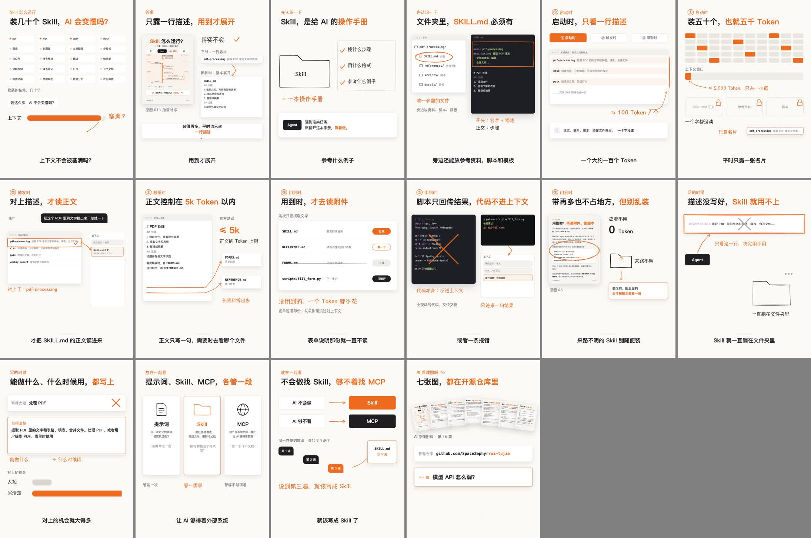

# ai-tujie-video

一个 Claude Code skill：把「AI 原理图解」里的一套图组（7 张 3:4 图 + HTML）做成 2–3 分钟的竖版讲解短视频。

<p align="center"></p>

## 做出来是什么样

- **画面**：白底手绘线稿 + 真实界面（窗口、编辑器、终端、文件列表）+ 原图卡片，元素跟着旁白关键词出现，字幕逐字对齐；沿用图组的橙色
- **配音**：微软官方音色，默认成熟男声「云扬」，语速 +15%，任何无声段不超过 0.5 秒
- **配乐**：程序合成的轻快拨弦 + 轻鼓，无版权问题，音量比人声低约 15 dB，说话时自动压低
- **封面**：个人 IP 形象 + 图组原标题 + 手绘装饰，嵌进 mp4



## 安装

```bash
git clone https://github.com/SpaceZephyr/ai-tujie.git
cp -r ai-tujie/skills/ai-tujie-video ~/.claude/skills/
cd ~/.claude/skills/ai-tujie-video/scripts && npm i
pip install edge-tts numpy
```

依赖：Node 22+、ffmpeg、Chrome，macOS（手写字体 Hannotate SC）。可选：mlx-audio + whisper-turbo + pypinyin，用来逐字对齐和对稿；没有的话按字数估算时间。

## 用法

在 Claude Code 里说：

> 把 ai-tujie 的 17-MCP 做成视频

skill 会依次：抽图组文字 → 写口播稿给你过目 → 分镜 → 配音 → 画面 → 封面 → 渲染合成。流程和每一步的命令见 [SKILL.md](SKILL.md)。

## 目录

```text
SKILL.md                 流程
scripts/init.sh          从图组建项目
scripts/extract_text.py  抽图组 HTML 文字
scripts/engine/          画面引擎（rough.js 手绘 + Puppeteer 逐帧渲染）
scripts/voice/           tts.sh 配音 · tighten.py 收紧停顿 · repause/finalize 对齐对稿 · gaps.py 查空白 · bgm.py 合成配乐 · mix_bgm.sh 合成成片
scripts/cover/           封面模板和截图
references/              口播稿写法、画面写法、踩过的坑
examples/16-Skill运行原理/ 完整例子
```

基于作者的 space-explainer-video skill 改造，MIT License。
